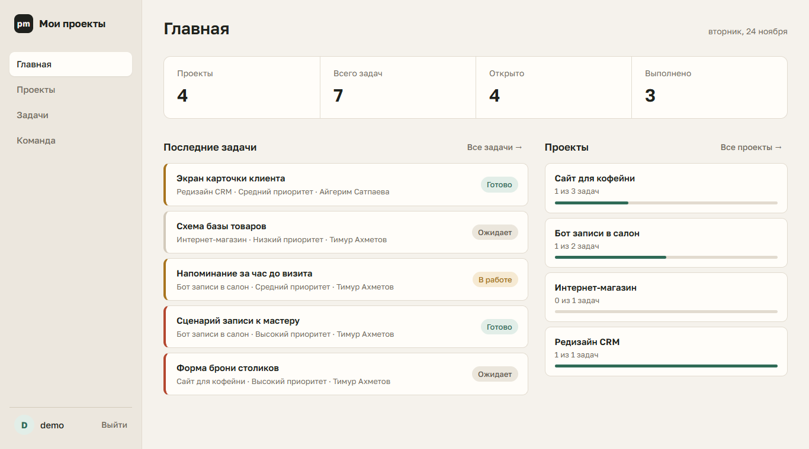
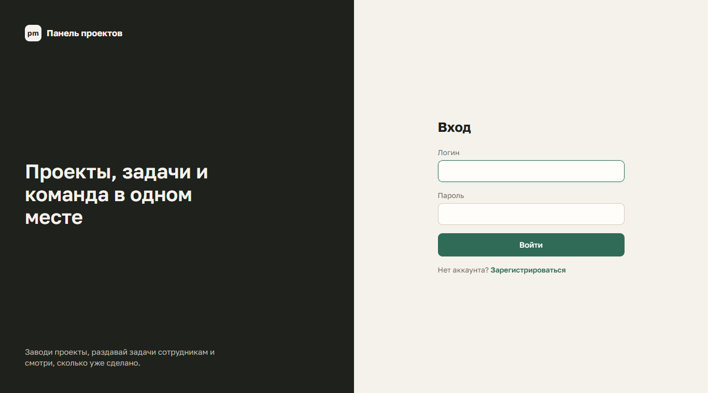
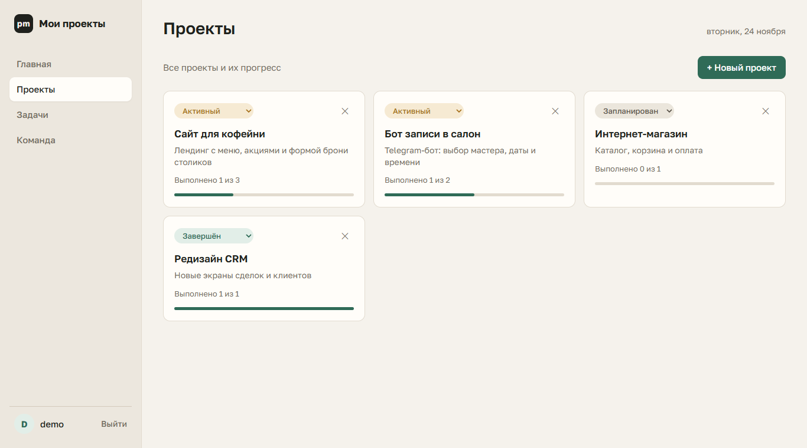
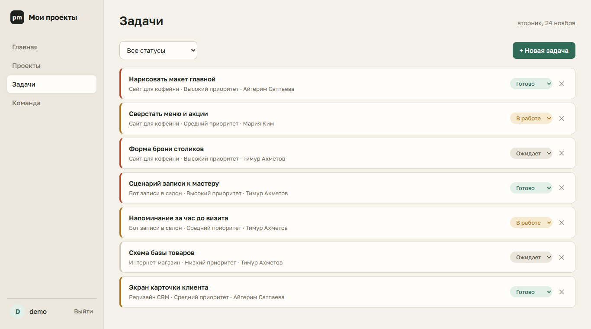
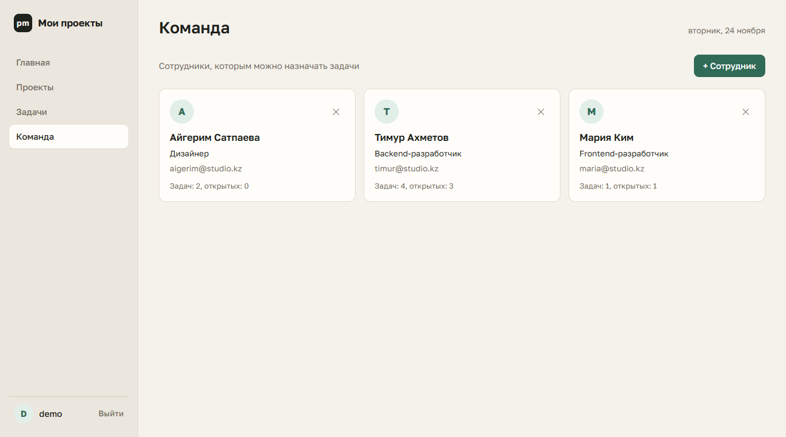
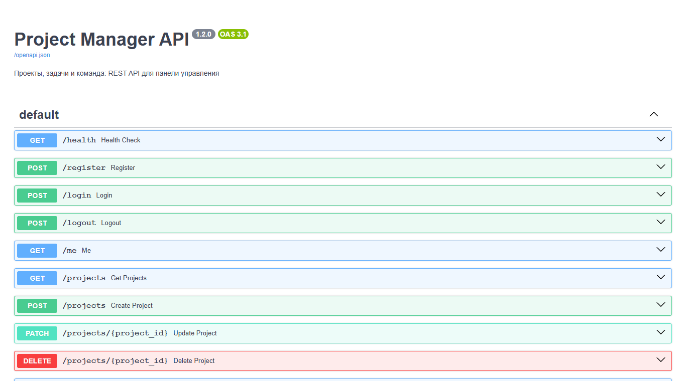

# Панель управления проектами

Веб-приложение для небольшой команды: проекты, задачи и сотрудники в одном месте.
Видно, кто чем занят, что уже сделано и сколько осталось по каждому проекту.
У каждого пользователя свой аккаунт и свои данные.



## Возможности

- **Аккаунты** — регистрация и вход по логину и паролю, выход. Каждый видит только свои проекты, задачи и команду
- **Дашборд** — сколько проектов и задач, сколько открыто и выполнено, последние задачи, прогресс по проектам
- **Проекты** — создание, смена статуса прямо на карточке, удаление вместе с задачами, полоска прогресса
- **Задачи** — приоритет (цветная полоска слева), статус, проект и исполнитель; смена статуса в один клик, фильтр
- **Команда** — сотрудники с должностью и email, сколько у каждого задач и сколько из них открыто
- Адаптивная вёрстка — нормально выглядит на телефоне

| Вход | Проекты |
|---|---|
|  |  |

| Задачи | Команда |
|---|---|
|  |  |

## Стек

- **Backend:** Python, FastAPI, SQLAlchemy 2.0, Pydantic, SQLite
- **Frontend:** HTML, CSS, JavaScript без фреймворков

## Как устроен вход

- Пароли не хранятся в открытом виде: PBKDF2-SHA256 с солью, 100 000 итераций
- После входа сервер выдаёт случайный токен и запоминает его в таблице сессий
- Сайт хранит токен в `localStorage` и отправляет в заголовке `Authorization: Bearer <токен>`
- Без токена API отвечает 401, а к чужому проекту — 403

## Запуск

```bash
cd backend
python -m venv .venv
.venv\Scripts\activate          # Windows  (Linux/macOS: source .venv/bin/activate)
pip install -r requirements.txt
uvicorn main:app --reload
```

Потом открыть `index.html` в браузере и зарегистрироваться.
База `database.db` создаётся сама при первом запуске.

Документация API (Swagger): http://127.0.0.1:8000/docs

## API

| Метод | Путь | Что делает |
|---|---|---|
| POST | `/register` | регистрация, возвращает токен |
| POST | `/login` | вход, возвращает токен |
| POST | `/logout` | выход (токен перестаёт работать) |
| GET | `/me` | текущий пользователь |
| GET | `/projects` | мои проекты |
| POST | `/projects` | создать проект |
| PATCH | `/projects/{id}` | изменить статус проекта |
| DELETE | `/projects/{id}` | удалить проект вместе с задачами |
| GET | `/tasks` | задачи моих проектов |
| POST | `/tasks` | создать задачу |
| PATCH | `/tasks/{id}` | изменить статус задачи |
| DELETE | `/tasks/{id}` | удалить задачу |
| GET | `/employees` | моя команда |
| POST | `/employees` | добавить сотрудника |
| DELETE | `/employees/{id}` | удалить сотрудника (его задачи остаются без исполнителя) |
| GET | `/health` | проверка, что сервер работает |

Все пути, кроме `/register`, `/login`, `/logout` и `/health`, требуют токен.



## Структура

```
backend/
  main.py        — эндпоинты API и проверка доступа
  models.py      — таблицы базы данных (SQLAlchemy)
  schemes.py     — проверка входящих данных (Pydantic)
  security.py    — хеширование паролей и токены
  database.py    — подключение к SQLite
index.html       — экран входа, страницы и окна
script.js        — вход, загрузка данных, отрисовка, действия
style.css        — оформление, адаптив под телефон
```

## Планы

- Редактирование названия и описания проекта и задачи
- Сроки задач и напоминания
- Срок жизни сессии
- Онлайн-демо
